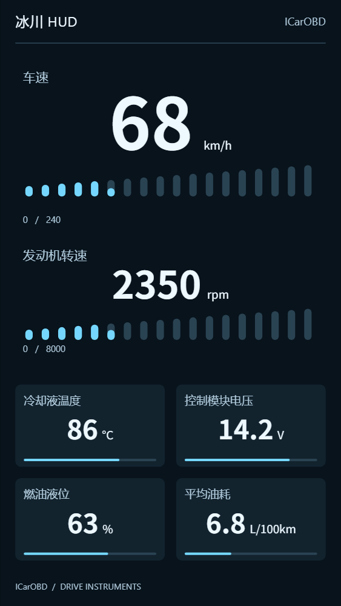
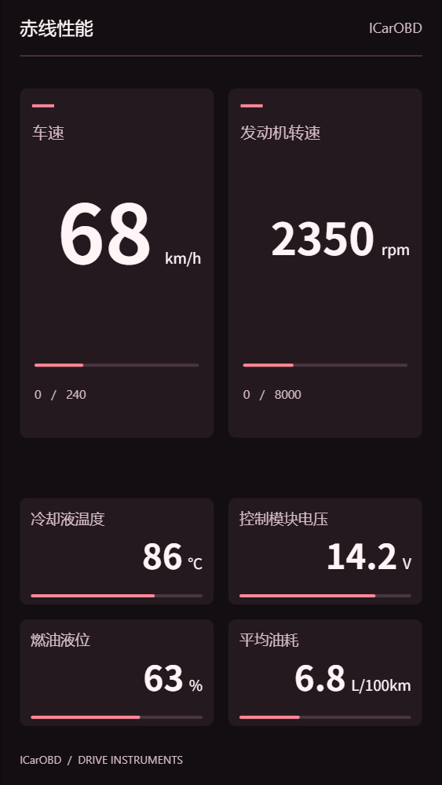
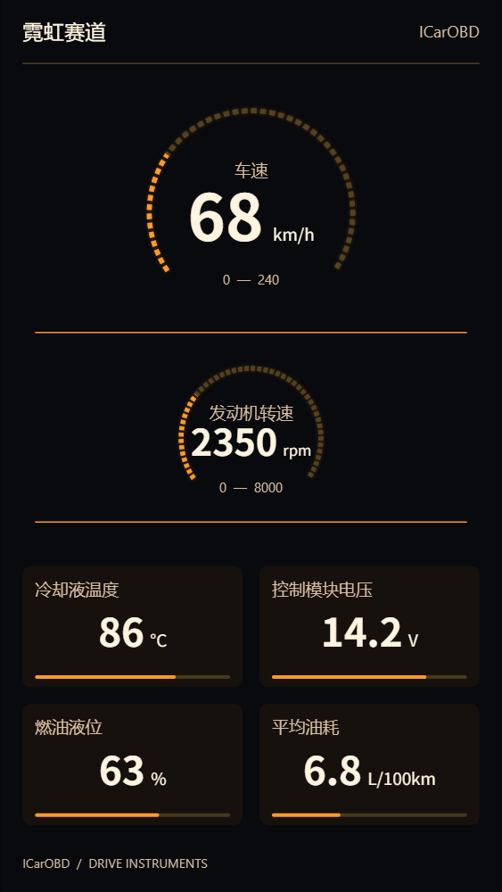
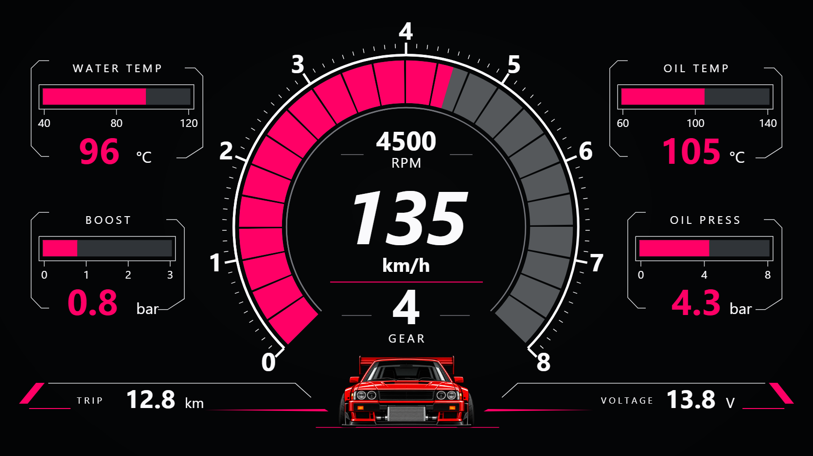
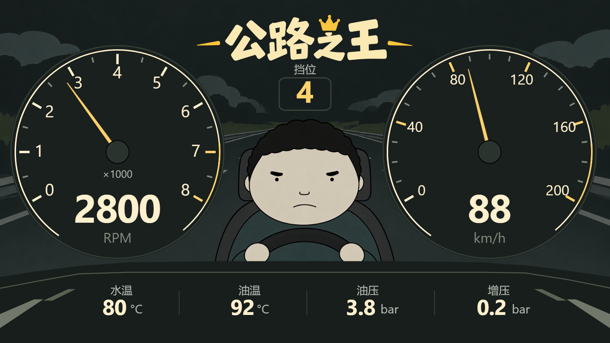
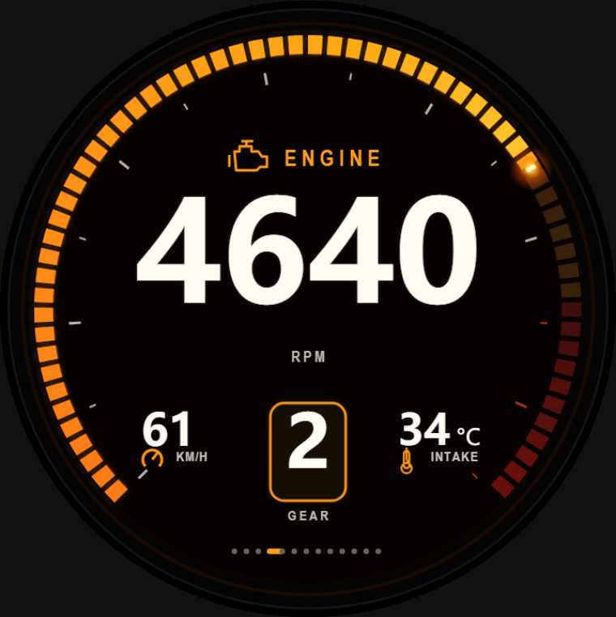

<strong>选一套仪表，在电脑上编辑，在手机和平板上运行。</strong> 24 款主题 · 62 个比例版本 · 配套 ICarUI 与 ICarOBD

<a href="#use">开始使用</a> · <a href="#publish">发布主题</a> · <a href="https://github.com/misakashiny/iCarOBD/releases/latest">下载 ICarOBD</a> · <a href="https://github.com/misakashiny/ICarUI-Private">ICarUI 编辑器（私有）</a>

---

## 一处主题，两端使用

这是 ICarUI 与 ICarOBD 共用的公开主题仓库，保存主题原件、可下载主题包和预览图。电脑编辑器与 Android App 读取相同的在线目录，主题不再随编辑器源码打包。

<table>
<tr><td width="33%"> <strong>冰川 HUD · 竖屏</strong></td><td width="33%"> <strong>赤线性能 · 竖屏</strong></td><td width="33%"> <strong>霓虹赛道 · 竖屏</strong></td></tr>
<tr><td width="33%"> <strong>霓虹赛道 · 车速版</strong></td><td width="33%"> <strong>公路之王 · 手绘双仪表</strong></td><td width="33%"> <strong>视频转速 · 粒子火花与扩散波纹</strong></td></tr>
</table>

图片展示主题样例读数；可选比例以在线目录为准，实际数据取决于车辆和已启用 PID。

## 最简单的用法

| 使用位置 | 操作 |
| :--- | :--- |
| **ICarUI 电脑编辑器** | 主题 → 在线主题 → 选择款式与比例 → 应用到画布 |
| **ICarOBD 手机 / 平板** | 主题与画布 → 浏览主题库 → 选择主题与比例 → 下载 → 添加为新画布 |
| 想自己修改 | 在 ICarUI 中继续编辑，导出检查后保存 `.icarzip` 或发布到此仓库 |

默认主题源：**`misakashiny/ICarUI-Theme`**。ICarOBD 1.21.27 会自动迁移旧默认源，自己添加的其他源、停用状态和已导入画布保留。日常使用只需刷新，无需输入令牌。

电脑先看样式，再选比例；App 优先显示接近当前屏幕的比例，详情里仍可切换。横版和竖版是作者各自设计的布局，进入全屏画布后遵循主题方向。已收藏或导入的主题可离线使用；在线目录与新下载需要网络。

首次整理包含霓虹赛道、赤线、道路仪表、九款组合、四配色、转速主题、默认仪表同款扩展以及两款社区入门主题。原 22 款 / 60 个版本全部保留，再加城市简约与白甲竞速。迁移包建议使用 ICarOBD **1.21.27（119）** 或更新版本。

## 如何上传自己的主题

1. 在 ICarUI 设计或打开主题，检查画布比例、数据绑定、零值与无数据状态。
2. 点击 **导出主题包 → 发布到 GitHub 主题库**，默认仓库已填好。
3. 填写主题编号、版本、作者与说明。使用仅对目标仓库具备 Contents 读写权限的令牌；发布器不会保存令牌。
4. 发布后，ICarUI 点击“刷新”，ICarOBD 刷新主题库，即可下载新版本。

发布到本仓库需要写权限。也可使用自己的公开主题仓库，手机在“主题源”中添加对应 `用户名/仓库名`。同一主题更新时提高版本号，发布器不会覆盖旧版本，也不会强制覆盖别人刚提交的目录。更新已归组的比例版本会保留原分组。

## 仓库分工

| 仓库 | 保存什么 |
| :--- | :--- |
| **ICarUI-Theme · 本仓库** | 主题原件、主题包、预览与在线目录 |
| [ICarUI-Private](https://github.com/misakashiny/ICarUI-Private) | 私有电脑编辑器源码、资源与测试 |
| [ICarOBD-Private](https://github.com/misakashiny/ICarOBD-Private) | 私有 Android App 源码、资源与测试 |
| [ICarOBD](https://github.com/misakashiny/iCarOBD) | APK、在线更新说明；旧主题分支保留供旧版兼容 |
| [ICarOBD-Data-Private](https://github.com/misakashiny/ICarOBD-Data-Private) | 私有数据目录、审核资料与个人 PID 同步 |

## 维护者说明

`theme-library` 分支是两端实际读取的在线目录。`main` 保存迁移时的原始创作资料与已验证发布快照；后续在编辑器发布的主题以在线分支为准，不会自动回写历史快照。

| 路径 / 分支 | 用途 |
| :--- | :--- |
| `source/` | 从 ICarUI 移入的 260 份原件，含生成脚本和历史演示资料 |
| `source-manifest.json` | 迁移前相对路径与 SHA-256，用于原件核对 |
| `library/` | 本次 62 个比例版本的已验证发布快照 |
| `theme-library:catalog.json` | 实际在线目录，schema 1 |
| `theme-library:themes/<id>/<version>/` | `theme.icarzip` 与 `preview.png` |

历史演示 HTML / 启动脚本保留原样，可能引用迁移前的编辑器相对路径；当前预览和编辑统一从 ICarUI 的“在线主题”进入。读取主题时只解析 JSON、图片和主题包，不运行源中的 JavaScript。

维护三端时将 `ICarOBD`、`ICarUI`、`ICarUI-Theme` 并列检出；也可通过 `ICARUI_DIR` 与 `ICAR_THEME_ROOT` 指定路径。Android 与浏览器回归直接读取本仓库中的主题包，不复制主题回编辑器源码。

格式约定见 [主题协议](docs/主题协议.md)。源码移出不改写旧 Git 历史；本仓库未另行授予统一开源许可，素材使用范围以各主题原始说明和权利人的授权为准。
