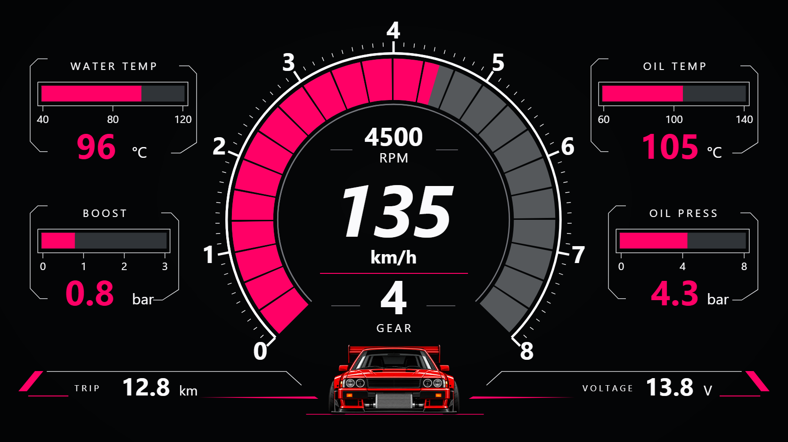
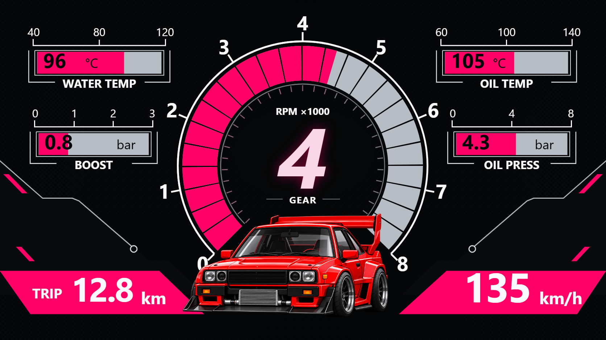

# 霓虹赛道 · 两款可编辑主题

用户原话：“这两个也做成主题包”。对应 `1 (1).png` 的车速版和 `1 (2).png` 的挡位版。转速环、温度/压力条、文字与读数均为 ICARUI 原生可编辑图层；赛车和背景为独立图片素材，已经装入主题包。

## 打开与导入

双击 [打开预览.cmd](打开预览.cmd)，或打开 [双主题互动预览](preview.html)。右上角选择车速版/挡位版和画布比例；下载按钮会跟随选择。支持原图读数、转速滑块、动态演示、全部归零和无数据。预览复用正式绘制代码，不加载编辑器草稿或主题库写入模块。

在 ICARUI 先保存当前设计，然后左侧「主题」→「导入主题」→选择 `.icarzip` →「存入主题库」→点击对应主题卡片→「应用到画布」。在「图层」展开分组，就能修改各项文字、颜色、位置、数据来源，或单独替换赛车图片。

| 布局 | 原图 1672×941 | 宽屏 1920×720 | 平板 1280×800 |
|---|---|---|---|
| 车速版：中央大车速、底部小车，186节点 | [车速版主题包](霓虹赛道_车速版_主题包.icarzip) | [车速版宽屏](其他比例/霓虹赛道_车速版_1920x720.icarzip) | [车速版平板](其他比例/霓虹赛道_车速版_1280x800.icarzip) |
| 挡位版：中央大挡位、底部大车与粉色底栏，139节点 | [挡位版主题包](霓虹赛道_挡位版_主题包.icarzip) | [挡位版宽屏](其他比例/霓虹赛道_挡位版_1920x720.icarzip) | [挡位版平板](其他比例/霓虹赛道_挡位版_1280x800.icarzip) |

另存了 [车速版可编辑JSON](霓虹赛道_车速版_可编辑主题.json) 和 [挡位版可编辑JSON](霓虹赛道_挡位版_可编辑主题.json)。**导入优先用主题包**，单独导入 JSON 不会自动带入图片；JSON 用于源码检查，手工转移时还需提供对应素材目录。其他比例的 JSON 也随包保留，素材原件集中在本目录 `assets/`。

三种比例按目标尺寸计算，保留原图构图并居中；宽屏左右、平板上下留深色空间。请按仪表实际内容区域的宽高比选择。不要只改 JSON 的画布宽高来跨比例使用，否则可能使图片、文字与转速环相互错位。

## 实际绘制效果

以下截图由 ICARUI 导入主题后绘制，使用原图演示数值。

## 数据来源

| 项目 | 来源/单位 | 说明 |
|---|---|---|
| 转速环，车速版的RPM数字 | `obd.rpm` → `std_0C`，rpm | 量程0～8000，24段；最后一段支持部分填充 |
| 车速 | `obd.speed` → `std_0D`，km/h | 支持三位数；缺源显示 `--` |
| WATER TEMP | `obd.coolant` → `std_05`，℃ | 进度范围40～120；数字保留真实值 |
| OIL TEMP | `obd.oil_temp` → `std_5C`，℃ | 进度范围60～140；需要车辆支持 |
| BOOST | `calc.boost` → `calc_boost`，输入kPa | 数字倍率0.01，显示bar；条范围0～300kPa；负增压数字仍显示，进度归零 |
| OIL PRESS | `user.oil_pressure_bar`，输入bar | 占位源，需改成实际油压源；进度0～8bar |
| GEAR | `obd.gear` | 当前未内置挡位采集，需配置真实源；0显示数字0，不推断为N |
| TRIP | `calc.trip` → `calc_km`，km | 本次行程，不是总里程 |
| VOLTAGE（车速版） | `obd.voltage` → `std_42`，V | ECU电压，需车辆支持 |

改同一指标的数据源时，应同时修改读数文字、进度条/转速环；挡位版数字还有一条同源霓虹特效。数字来源缺失显示 `--`，进度不填充，挡位光效退出；合法0仍显示0。预览的4500转、135km/h、4挡、96℃等是离线示例，不会写成车辆数据。原图中的部分进度长度与其数字不严格成比例，本主题按标注量程和实际数值计算。

## 素材与维护

- [正面赛车PNG](assets/car-front.png) 和 [斜前赛车PNG](assets/car-angle.png) 由内置 imagegen 按参考图重建为透明素材，保留生成透明通道；不是原图逐像素裁切，细节存在差异。[完整提示词记录](asset-prompts.json)。
- 深黑/碳纤维纹理由生成器确定性绘制，赛车、背景均可独立移动、替换或删除。主题不包含整张参考仪表截图。
- 使用系统 `sans` 字体，不分发字体文件；Android与电脑字形可能不同。主题使用现有v3格式，本轮未改公共渲染器或Android代码。
- [build-themes.cjs](build-themes.cjs) 生成两款主题及各比例、背景、预览数据。运行会覆盖本目录生成文件；请把自己在编辑器修改后的作品另存为独立文件名。

本地实际导入、导出回读、素材CRC、三种比例与交互已验证，[完整记录](../../../../docs/02_验证记录/20261026_ICarUI双霓虹赛车主题.md)。本轮未构建新APK、未安装或操作设备；用户视觉、APP原生显示/性能与真车数据未验。
