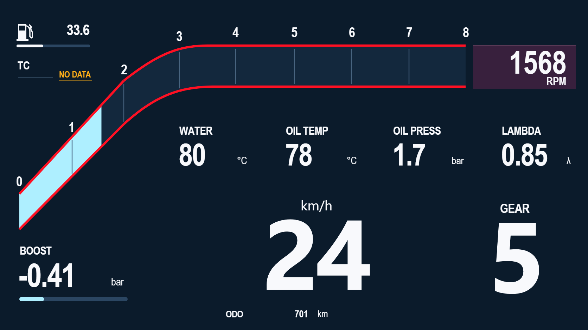

# 红线赛车 · 参考图2

依据用户提供的 `2.png` 复刻。主题包含12个功能分组、106个可编辑节点，使用现有 `icar.ui/3` 格式；轮廓、进度条、文字与数据读数均为独立图层，无外部图片依赖。

## 先看效果

双击 [打开预览.cmd](打开预览.cmd)，或打开 [preview.html](preview.html)。预览使用 ICARUI 实际绘制代码，可切换原图读数、动态演示、全部归零、无数据；拖动转速滑块查看0～8000 RPM填充。

预览页右上角可选原图、宽屏或平板比例，下载按钮会对应所选文件。它不加载草稿与主题库模块，不保存或覆盖编辑器里的现有设计。

## 导入并编辑

1. 在 ICARUI 中先保存当前设计。
2. 左侧选择「主题」→「导入主题」，选择下面对应的 `.icarzip`。
3. 确认「存入主题库」，再点击该主题卡片→「应用到画布」。导入到库和应用是两个步骤。
4. 在「图层」中选择相应分组，展开或进入组内后修改标题、字体、颜色、位置或数据绑定。
5. 完成后保存 JSON；导入 APP 时推荐导出/使用 `.icarzip`。

| 目标画布 | 主题包 | 可编辑文件 |
|---|---|---|
| 原图 1672×941，约16:9 | [红线赛车_主题包.icarzip](红线赛车_主题包.icarzip) | [红线赛车_可编辑主题.json](红线赛车_可编辑主题.json) |
| 宽屏 1920×720 | [宽屏主题包](其他比例/红线赛车_1920x720.icarzip) | [宽屏JSON](其他比例/红线赛车_1920x720.json) |
| 平板 1280×800，16:10 | [平板主题包](其他比例/红线赛车_1280x800.icarzip) | [平板JSON](其他比例/红线赛车_1280x800.json) |

请按**仪表内容区域的实际宽高比**选择，不按设备标称屏幕分辨率猜测。三个文件分别排版，保留原图比例并居中；宽屏两侧和16:10上下留深色空间。已有渲染器按不同规则计算位置和叶节点尺寸，直接把原图版本改成另一比例会造成分段间隙；请使用对应版本。相同宽高比的不同分辨率可以等比显示，其他比例需另行生成/排版。

APP中通过「画布与通知」的主题导入入口选择文件。本轮未修改Android代码、未生成新APK，未安装用户设备；APP实际显示及真实车辆数据仍待验证。

## 数据绑定

主题正常导入后没有车辆信号时显示 `--`，转速填充熄灭。预览中的1568、24、5等值只属于离线演示，不随主题写成真实读数。

| 画面项目 | 绑定与单位 | 使用说明 |
|---|---|---|
| 转速数值与转速带 | `obd.rpm` / `std_0C`，rpm | 0～8000，8段各自对齐对应千转刻度 |
| 车速 | `obd.speed` / `std_0D`，km/h | 已留三位数显示空间 |
| WATER | `obd.coolant` / `std_05`，℃ | 合法0显示0，缺源显示-- |
| OIL TEMP | `obd.oil_temp` / `std_5C`，℃ | 需要车辆支持该通道 |
| 燃油33.6 | `obd.fuel_level` / `std_2F`，% | 参考图未标单位，本主题按百分比实现，不能当作33.6升 |
| BOOST | `calc.boost` / `calc_boost`，原始kPa | 数字显示倍率0.01换算bar；进度量程-100～200 kPa，对应-1～2 bar |
| ODO | `obd.odo` / `std_A6`，km | 总里程，不拿本次行程冒充；车辆支持性待确认 |
| GEAR | `obd.gear`，预留绑定 | 项目当前没有内置挡位采集，需改成实际自定义源；0按数值0显示 |
| OIL PRESS | `user.oil_pressure_bar` | 占位ID，需绑定**实际输出bar**的油压源；如源为kPa，数值倍率改0.01 |
| LAMBDA | `user.lambda` | 占位ID，需绑定实际λ信号，不将普通氧传感器电压当作λ |
| TC | 固定 `NO DATA` | 目前没有可信TC来源，不显示虚构的正常状态 |

在读数文字的属性面板中开启/编辑「显示实时数值」即可修改来源、精度和显示倍率。改转速源时，需同时修改转速数字及组内8段填充的来源。

## 字体、维护与验证

电脑端窄体优先使用本机 Arial Narrow，其次 Roboto Condensed，再回退系统字体；Android沿用系统 `sans-serif-condensed`。字体外形会因平台略有不同，不携带或分发系统字体文件。

生成入口为 [build-theme.cjs](build-theme.cjs)，主题数据载入文件为 [theme-data.js](theme-data.js)，预览交互为 [preview.js](preview.js)。重新运行生成器会覆盖本目录的主题JSON、主题包及theme-data.js；**在编辑器中另存的用户设计应使用独立文件名**。

本轮实际导入、零值/缺源、动态预览、三个比例和相关回归证据见 [验收记录](../../../../docs/02_验证记录/20261026_ICarUI参考图2仪表复刻.md)。用户视觉确认、APP实机和真车未验。
