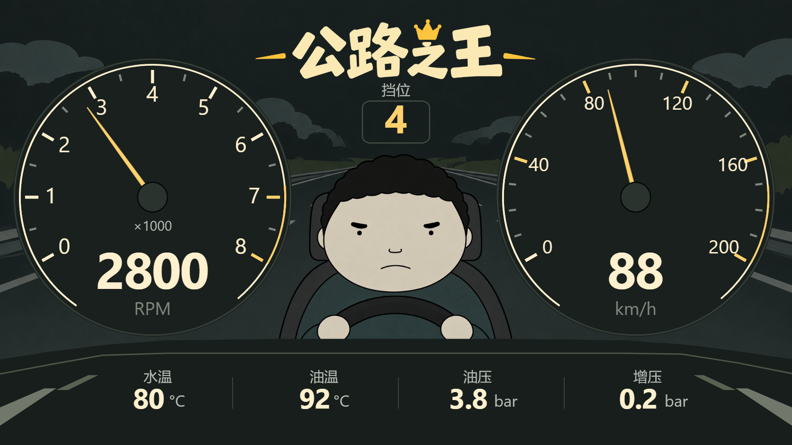

# 公路之王 · 手绘双仪表

根据用户参考图 `3.png` 制作。保留奶油色/金色双圆仪表、手绘公路、中央司机和“公路之王”标题。105个可编辑节点、4张独立素材，使用现有 `icar.ui/3` 格式。

## 预览与下载

双击 [打开预览.cmd](打开预览.cmd)，或打开 [互动预览](preview.html)。可分别调节转速和车速、播放动态演示、恢复参考读数、全部归零或查看无数据状态。预览不加载编辑器草稿和主题库写入模块。

| 目标画布 | 含素材主题包 | 可编辑JSON |
|---|---|---|
| 原图 1672×941 | [公路之王主题包](公路之王_主题包.icarzip) | [原图JSON](公路之王_可编辑主题.json) |
| 宽屏 1920×720 | [宽屏主题包](其他比例/公路之王_1920x720.icarzip) | [宽屏JSON](其他比例/公路之王_1920x720.json) |
| 平板 1280×800 | [平板主题包](其他比例/公路之王_1280x800.icarzip) | [平板JSON](其他比例/公路之王_1280x800.json) |

按仪表内容区域的实际宽高比选择。三份分别计算位置，保留原图比例并居中，宽屏左右/平板上下有深色留白。不要只修改画布尺寸来跨比例使用，否则图片、叶节点和指针部件可能错位。

## 导入与编辑

1. 先保存当前设计。
2. ICARUI左侧「主题」→「导入主题」→选择 `.icarzip` →「存入主题库」。
3. 点击该主题卡片→「应用到画布」。
4. 在「图层」展开左右仪表、挡位、底栏分组，修改文字、颜色、位置和来源。

推荐使用主题包，里面已包含公路、司机、标题和指针素材。单独导入JSON不会自动带入图片；素材原件统一放在本目录 `assets/`，其他比例JSON也需要这些素材。导入APP同样推荐 `.icarzip`。

司机、公路和标题是独立图片，可以整体移动、缩放、替换；标题不是逐字可编辑文本。仪表刻度和数字是原生图层。两根指针使用原生仪表部件，支持调整轴心、长度、角度范围和数据来源；指针的金色外形由独立透明PNG提供。

## 数据与指针

| 画面项目 | 绑定 | 单位及范围 |
|---|---|---|
| 左指针与转速数字 | `obd.rpm` → `std_0C` | 0～8000 RPM；刻度0～8表示×1000 |
| 右指针与车速数字 | `obd.speed` → `std_0D` | 0～200 km/h |
| 挡位 | `obd.gear` | 预留实际源；0显示0，不自行推断为N |
| 水温 | `obd.coolant` → `std_05` | ℃ |
| 油温 | `obd.oil_temp` → `std_5C` | ℃，需要车辆支持 |
| 油压 | `user.oil_pressure_bar` | 占位源，须配置实际输出bar的数据源 |
| 增压 | `calc.boost` → `calc_boost` | 输入kPa，乘0.01显示bar，保留一位小数 |

两根指针按150°～390°均匀映射，超过量程时停在端点，独立数字仍显示实际值。**参考图中右指针与88km/h的刻度位置不一致，主题按正确量程指向88km/h。** 2800RPM对应234°，88km/h对应255.6°。

来源缺失时数字显示 `--`，指针隐藏；合法0会显示0并指向起点。预览中的2800、88、4等只用于离线演示，不写入实际车辆数据。改来源时同时修改数字和指针所属仪表；指针子部件保持来源为空以继承所属仪表的明确量程，避免误用PID目录默认量程。

## 素材与维护

- [公路背景](assets/road-background.png)、[司机](assets/driver.png)、[标题](assets/title.png) 使用内置 imagegen 按参考重建，透明通道原样保留；与参考图存在细节差异，并非原像素裁切。[完整提示词](asset-prompts.json)。
- [指针](assets/needle.png) 由生成器绘制；表盘、刻度、读数和前景面板使用原生节点，没有把整张参考图当作仪表贴图。
- [build-theme.cjs](build-theme.cjs) 会重新生成主题包、JSON、指针和预览数据。用户修改后的作品请另存为独立文件名。
- 使用系统sans字体，Android与电脑字形可能不同。本轮不修改公共渲染器或APP，不生成新APK。

本地导入、回读、素材CRC、三个比例、动态指针/读数、零值/缺源已检查，详见[验证记录](../../../../docs/02_验证记录/20261026_ICarUI公路之王主题.md)。用户视觉、APP原生布局/性能、真实数据源与真车仍未验。
